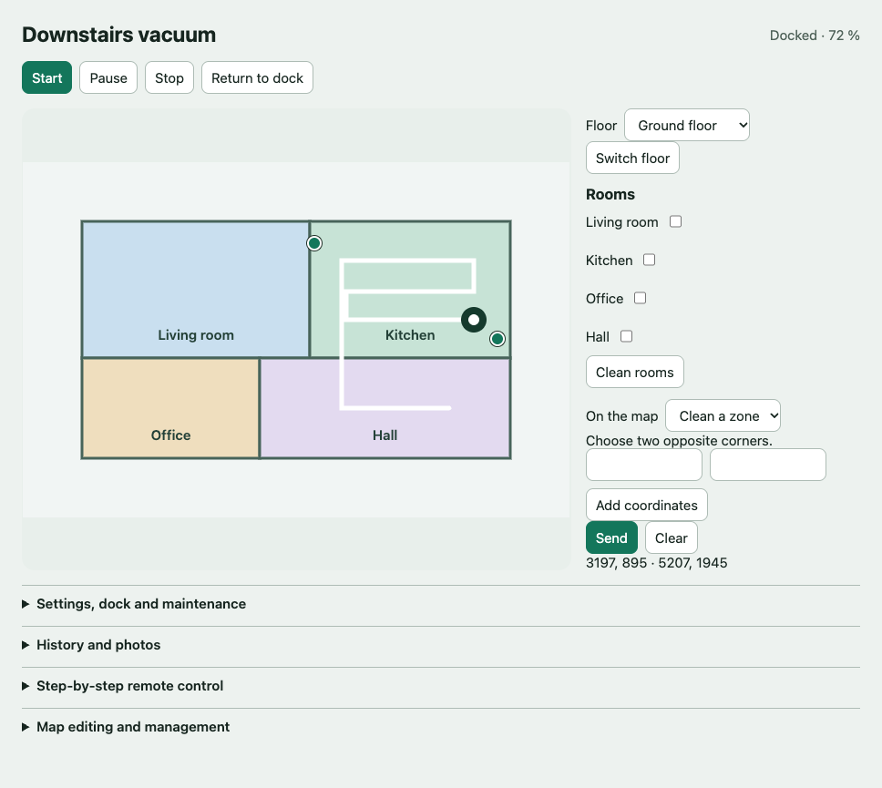

# Dreame Open Card

An independent, free Lovelace card for Dreame vacuums. It uses Home Assistant entities, actions and camera images without an activation key. The card is MIT-licensed.



## Install with HACS

1. In HACS, open the menu and choose **Custom repositories**.
2. Add `https://github.com/Minims/dreame-open-card` as a **Dashboard**.
3. Open **Dreame Open Card** and choose **Download**. Under **Need a different version?**, select the `2026.11.0a` prerelease. If your HACS version hides prereleases, enable **Show beta versions** for the repository first.
4. Add the card manually using the YAML below. HACS registers the JavaScript resource in dashboard storage mode. For YAML-managed resources, use the resource URL shown by HACS.

Install and configure [Dreame Vacuum](https://github.com/Tasshack/dreame-vacuum) before adding the card.

## Manual installation

1. Install and configure [Dreame Vacuum](https://github.com/Tasshack/dreame-vacuum). In **Developer tools → States**, find your vacuum entity and, if available, its live map camera entity.
2. Download [dreame-open-card.js](dreame-open-card.js) and copy it to `/config/www/dreame-open-card.js`. Restart Home Assistant if you just created the `www` directory.
3. In **Settings → Dashboards → Resources**, add `/local/dreame-open-card.js` as a **JavaScript module**. Enable Advanced mode in your profile if the Resources menu is hidden.
4. Add a manual card to your dashboard. Replace the example entity IDs with your own.

```yaml
type: custom:dreame-open-card
entity: vacuum.dreame
map_camera: camera.dreame_map
```

`map_camera` and `title` are optional. Use a **Panel** view for a full-width card. The card also supports an internal responsive panel mode and additive map display settings:

```yaml
type: custom:dreame-open-card
entity: vacuum.dreame
map_camera: camera.dreame_map
mode: panel
features:
  dock: true
  maintenance: true
  history: true
  remote: true
  editing: true
map:
  rotation: 0
  scale: 1
  offset: [0, 0]
```

If the card cannot discover your settings and maintenance entities, list them explicitly.

```yaml
type: custom:dreame-open-card
entity: vacuum.dreame
map_camera: camera.dreame_map
title: Upstairs vacuum
entities:
  - button.dreame_auto_empty
  - select.dreame_cleaning_mode
  - sensor.dreame_main_brush_left
```

The card follows the Home Assistant frontend language. It displays French for French locales and falls back to English for other locales. Entity names, options, map labels and error details supplied by Home Assistant or the integration keep their original wording.

## Features

- Start, pause, stop, return to dock, locate and see the battery level.
- Clean rooms, zones or spots, send the robot to a point and switch floors. Map selection requires a live map camera with calibration data.
- Control the dock, change settings and see maintenance data through entities exposed by the integration. Scheduling controls depend on the entities available on the instance.
- View history and obstacle photos, see error details and send step-by-step remote control commands where supported.
- Rename, split and merge rooms, back up and restore maps, and edit walls, restricted zones, carpets, furniture and floor materials through action forms. Advanced actions require confirmation. The field names match the Home Assistant action schema.
- Use responsive panel mode with Home Assistant theme colors, keyboard-focus styles and capability-driven controls. Unsupported model actions remain hidden or disabled instead of producing invalid service calls.

Feature availability depends on the vacuum model, integration version and enabled entities. The card was developed against Dreame Vacuum v2.0.3. Full graphical map editing, custom floor backgrounds, continuous steering and live video are outside the current implementation.

## Development

Run `npm test` with Node.js. The card ships as one JavaScript module and has no build dependencies.

The repository layout follows the [Lovelace boilerplate recommended by HACS](https://github.com/custom-cards/boilerplate-card). CI runs the Node tests and HACS plugin validation. Publishing a GitHub release attaches the JavaScript file from its tag. The tag must match `CARD_VERSION` in the module.

[Reverse-engineering report](docs/reverse-engineering.md) · [MIT license](LICENSE)
